<div align="center">

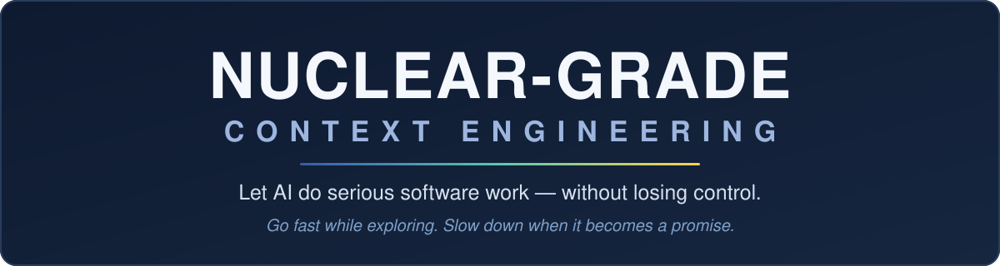

<br/>

**A simple, evidence-first way to let AI do serious software work and stay in control of what ships.**

[](https://github.com/FlyFission/nuclear-grade-context-engineering/actions/workflows/ci.yml)
[](LICENSE)
[](pyproject.toml)
[](#quick-start)
[](CONTRIBUTING.md)
[](.nuclear/changes/)

</div>

# Nuclear Grade Context Engineering

**Your AI agent wrote the code, the tests, and the PR description. Who checked?**

A small, dependency-free toolkit that keeps agent work questioned, controlled, and reviewable:

- **Every claim linked to evidence**, with a record of *who* generated, selected, and presented it, so you can see when an agent graded its own work.
- **Checks that ignore the agent's narrative**: a CI validator, receipts with file digests, and an opt-in hook that stops agents editing the files that judge them.
- **Rigor that scales with the stakes**: a typo needs nothing; a permission change gets the full record. Skills and prompt cards for Claude Code, Codex, Cursor, and more.

Borrows high-consequence engineering discipline, not its regulations ([limits](#limits)).

<p align="center">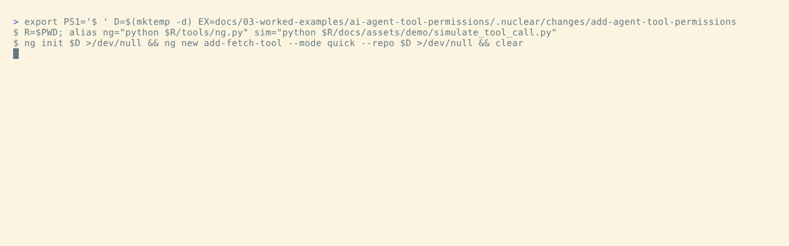</p>

<details><summary>Text transcript of the demo</summary>

1. `sim Write .github/workflows/ci.yml` → `DENY`: protected trust surfaces go to human review, not the agent.
2. `sim Bash "git push --force origin main"` → `ASK`: a force push needs a human.
3. `ng validate <worked example> --json` → `"ok": true`, `"open_evidence_items": 2`; `ng badge .` reports records and open items.
4. `ng validate` on a fresh, unfilled record → `FAILED`.

`sim` sends a simulated tool call through `hooks/pre_tool_use.py`; no agent runs. Recording: [`docs/assets/demo/demo.tape`](docs/assets/demo/demo.tape); a test replays its commands. Re-render with `vhs docs/assets/demo/demo.tape`.

</details>

## Contents

[See it work](#see-it-work) · [Quick start](#quick-start) · [The one idea](#the-one-idea) · [The skills](#the-skills) · [Adopt at your pace](#adopt-at-your-pace) · [Keep the approved version](#keep-the-approved-version) · [Common way vs. nuclear-grade](#common-way-vs-nuclear-grade) · [Does it work?](#does-it-work) · [Limits](#limits) · [Project](#project)

## See it work

A finished change record for a change that should make you nervous: letting an agent write files and call external APIs. Passing tests for the narrow claim, named gaps for the rest, and an honest note that its evidence path is mostly coupled to one AI-assisted maintainer. Standard library only; needs `git` and Python 3.11+.

```bash
git clone https://github.com/FlyFission/nuclear-grade-context-engineering
cd nuclear-grade-context-engineering
python tools/ng.py validate docs/03-worked-examples/ai-agent-tool-permissions/.nuclear/changes/add-agent-tool-permissions --strict-custody
# OK: the record links claims to evidence and discloses custody/coupling (or a named gap).

python -m pytest docs/03-worked-examples/ai-agent-tool-permissions/tests/test_workspace_guard.py -v   # needs pytest
# 4 passed: every write outside the agent's workspace was denied and logged.

echo '{"tool_name":"Write","tool_input":{"file_path":".github/workflows/ci.yml"},"cwd":"'"$PWD"'"}' | python hooks/pre_tool_use.py
# {"hookSpecificOutput": {... "permissionDecision": "deny", ... "protected trust surface (.github/workflows/**)" ...}}

python tools/ng.py validate docs/03-worked-examples/ai-agent-tool-permissions/.nuclear/changes/add-agent-tool-permissions --json
# "ok": true, "evidence_statuses": {"pass": 5, "deferred": 2, ...}, "open_evidence_items": 2, "inputs": {"digest": "..."}
```

Copy [that example](docs/03-worked-examples/ai-agent-tool-permissions/) as your template; [`QUICKSTART.md`](QUICKSTART.md) is the guided tour. It is a teaching example, not a production guarantee.

**Test your own agent:** [`challenge/`](challenge/README.md) is a 15-minute game. A routine request quietly widens a toy agent's authority; `score.py` checks whether your agent recorded it, named what is unproven, and left the release to a human. One seeded trap, not a safety rating.

## Quick start

**Claude Code** (the repo is its own plugin marketplace):

```bash
/plugin marketplace add FlyFission/nuclear-grade-context-engineering
/plugin install nuclear-grade@nuclear-grade
/reload-plugins
```

Adds the skills and command cards. No hooks, nothing runs on its own, and no `ng` on your `PATH`; the CLI runs from a checkout.

**Any tool, or plain files:**

1. Clone and install (no third-party dependencies): [`INSTALL.md`](INSTALL.md).
2. `python tools/ng.py doctor .` and `python tools/ng.py list`.
3. `python tools/ng.py new <slug> --mode quick`, fill two files, then `python tools/ng.py validate .nuclear/changes/<slug>`.

Using an agent? Point it at [`AGENTS.md`](AGENTS.md), the brief agents read first.

| You get | What it does | Start here |
|---|---|---|
| Skills | Instructions an agent follows: inputs, outputs, how to verify, when to stop | [`SKILLS.md`](SKILLS.md) |
| Command cards | Paste-ready `/ng-*` prompts generated from the skills | [`COMMANDS.md`](COMMANDS.md) |
| Templates | Fill-in records for small, standard, and high-consequence changes | [`templates/`](templates/) |
| CLI and checker | `new`, `validate` (with `--json` receipts and `--two-party`), `doctor`, `status`, `badge`, `install`, `tokens` | [`cli-reference.md`](docs/05-reference/cli-reference.md) |
| Hooks (opt-in) | Advisory session routing, plus a `PreToolUse` gate that never auto-allows and fails closed | [`HOOKS.md`](HOOKS.md) |
| Evidence badge | Counts your records and their open evidence items; shows gaps, never "certified" | [`cli-reference.md`](docs/05-reference/cli-reference.md) |
| Workflows and diagrams | The path step by step, and every diagram in one place | [`WORKFLOWS.md`](WORKFLOWS.md), [`docs/diagrams.md`](docs/diagrams.md) |

Repo map: [`docs/README.md`](docs/README.md). Live catalog: [`nuclear-grade.yaml`](nuclear-grade.yaml); counts here are snapshots.

## The one idea

**Go fast while exploring. Slow down the moment the work becomes a promise.**

Throwaway ideas are cheap; let the agent try them. Rules tighten when work becomes a claim, a controlled file, a public statement, an approved version, a release, or a change to what the agent may do.

- **Minimum sufficient context.** The smallest set of instructions, facts, limits, and evidence that does the job. A field that does not improve execution, verification, review, or a decision gets cut.
- **Who authored the evidence?** The agent that builds a change also drafts its evidence, writes the narrative, and frames the decision, so a confident mistake can arrive wrapped in convincing proof. Records track **evidence custody** and an **actor–evidence coupling profile** (actor, context, mechanism, authority, resource), and the load-bearing claim's evidence must be reproducible by the reviewer or produced by someone independent ([details](docs/02-operating-system/actor-evidence-independence.md)).

Every change walks one path. Zoomed out it is three moves, **PRO**: Plan · Run · Operate. With the gate named it is five, **PROVE**: Plan · Run · Observe · Verdict · Educate. The step you never fold away is **Verdict**, where a draft becomes a decision.

<p align="center">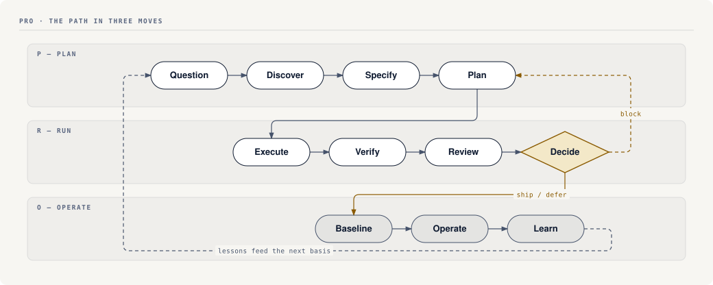</p>

<details>
<summary>Mermaid source (text version)</summary>

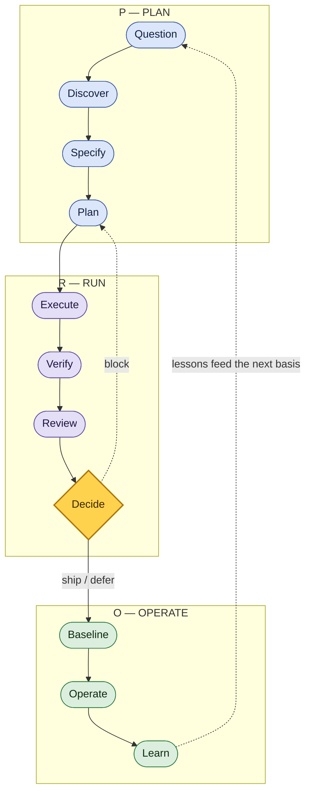

</details>

In text (for PyPI and other places SVGs do not render):

```text
Question -> Discover -> Specify -> Plan -> Execute -> Verify -> Review -> Decide -> Baseline -> Operate -> Learn
```

Each step stops one failure and leaves one artifact you can point at; a skipped step is a failure mode you chose to accept ([`WORKFLOWS.md`](WORKFLOWS.md)). Under the path sit optional habits from high-reliability work, **HPI for AI agents** (Human Performance Improvement): brief before a risky step, double-check critical actions, hand off cleanly, get independent eyes when trust is on the line, learn from near misses.

## The skills

Each skill is one job, with a trigger, a procedure, the record it leaves, and the decision it can block. A host shows the agent only each skill's name and one-line description; the full instructions load only when a skill is picked.

<p align="center">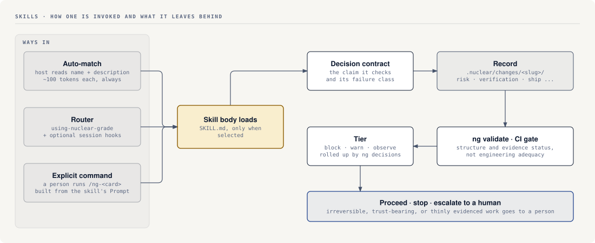</p>

<details>
<summary>Mermaid source (text version)</summary>

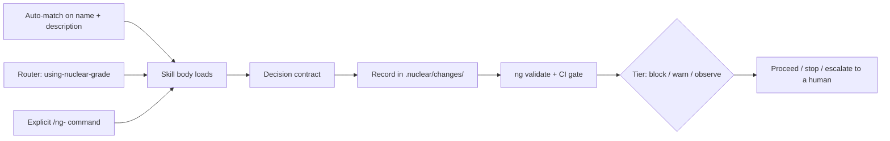

</details>

All 31, by family, with the situation that calls for each (gold dot = the Core 7, used on every change):

<p align="center">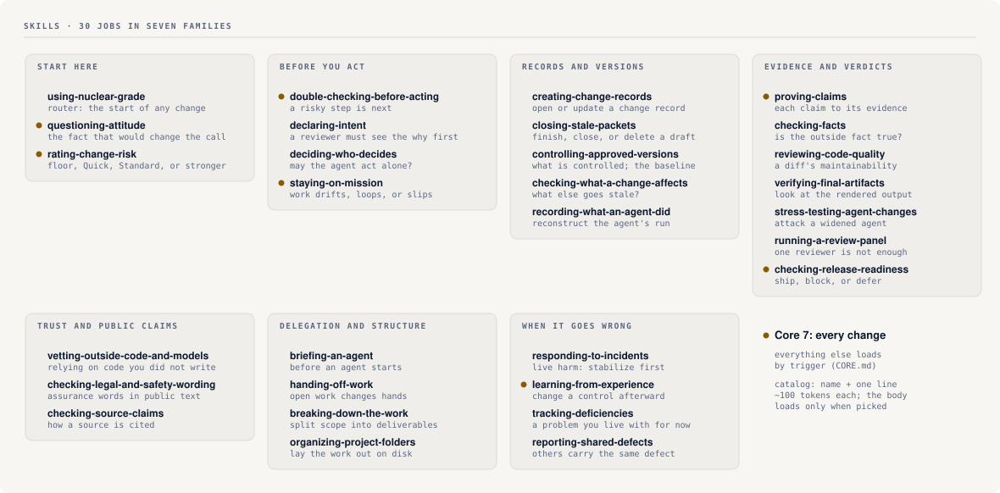</p>

Text list, full map, and how they compose: [`SKILLS.md`](SKILLS.md). Which skills fire for which kind of change: [`CORE.md`](CORE.md).

## Adopt at your pace

Rigor scales with consequence, not effort.

- **Start with the Core 7**, always-on habits that fit any change ([`CORE.md`](CORE.md)).
- **Add skills by trigger** when a change touches users, data, dependencies, permissions, AI authority, or a release; [`starter-kit/`](starter-kit/) has ready-made bundles.
- **Grow into the full system** once the lighter path works for your team.

Which record does a change need? Both kinds live in `.nuclear/changes/<name>/`:

<p align="center">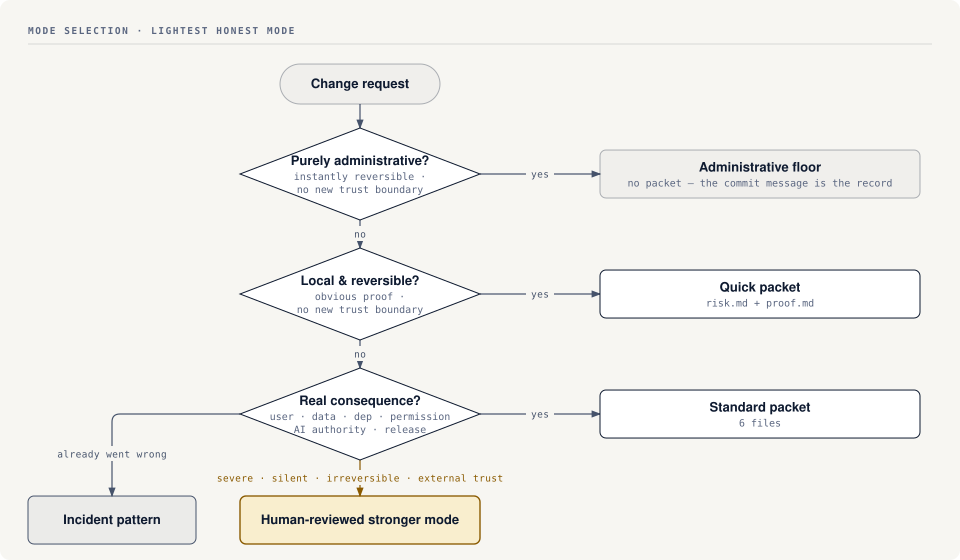</p>

<details>
<summary>Mermaid source (text version)</summary>

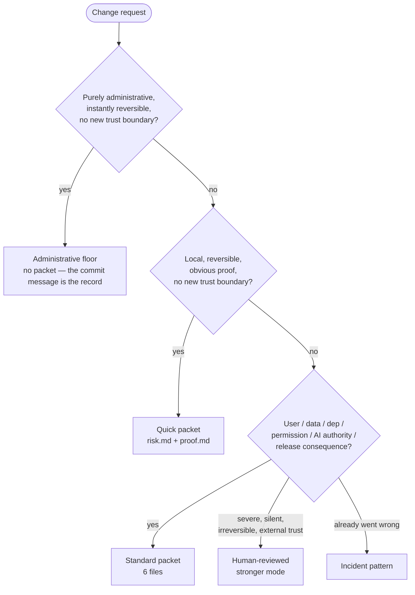

</details>

Quick = `risk.md` + `proof.md`. Standard = `risk.md`, `basis.md`, `plan.md`, `trace.md`, `verification.md`, `ship.md`. Heavier patterns (high-consequence, incident, research-board, release) are written down; treat them as human-reviewed until your project has tested them.

## Keep the approved version

Git, CI, and branch protection stay; this rides on top. A green pipeline says tests passed on a commit, not that someone weighed the leftover risk and chose to ship, or what would force a re-check. Nor do they cover what now drives an agent: prompts, model IDs, eval sets, `AGENTS.md`/`CLAUDE.md`, skills, and the agent's own permissions.

A **baseline** is the version everyone agreed is correct, plus the evidence behind it. Changes reach it only through evidence and a decision:

<p align="center">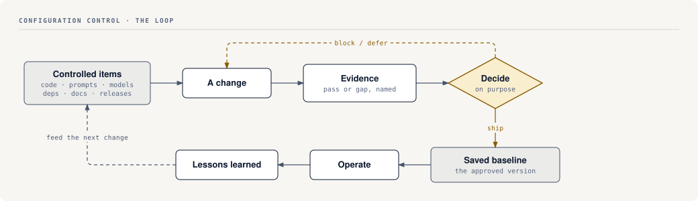</p>

<details>
<summary>Mermaid source (text version)</summary>

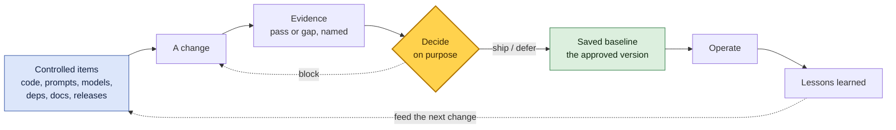

</details>

## Common way vs. nuclear-grade

| Common way | Nuclear-grade |
|---|---|
| Ask an agent, look at the diff, run the tests. | Question assumptions, name what is controlled, check evidence, decide on purpose, record what you trust. |
| PR text argues for a yes. | A record links intent, what must not break, evidence, gaps, and the decision. |
| The agent writes the code, the evidence, and the summary. | Load-bearing evidence is reproducible by the reviewer or produced independently. |
| Broad access, vague instructions. | A role, what it may and may not do, what it must prove, and when to stop. |
| Green tests = ship. | A release record: evidence, leftover risk, rollback, what to watch, the decision. |
| Lessons vanish into chat. | Lessons change future plans, tests, monitors, and controls. |

Who it is for: teams whose agents write files, call APIs, touch credentials, or affect releases; reviewers who want evidence instead of a pitch. Works as plain markdown in any tool; native plugins for Claude Code and Codex ([`INTEGRATIONS.md`](INTEGRATIONS.md)).

## Does it work?

Measured honestly, so far:

- **Skills vs. a strong generic prompt** ([`evals/skill-control-ladder/`](evals/skill-control-ladder/)): full skills beat one fixed "careful reviewer" paragraph by +0.10 on 27 repo-authored scenarios (p < 0.0001). That did **not** replicate on seven harder scenarios. One model family; repo-written rubrics.
- **Twelve-scenario comparison** ([`skill-workflow-comparison/`](docs/03-worked-examples/skill-workflow-comparison/)): a design inspection, author-judged, not an experiment.
- **Not yet done**: a preregistered, blinded study of false acceptance and reviewer calibration with independent evidence. Until then the honest claim is narrow: an inspectable implementation of evidence-custody and actor–evidence-coupling controls ([novelty review](docs/06-publications/research/exhaustive-novelty-review-2026-07-19.md)).

## Limits

Not a compliance program, certification, regulated quality-assurance system, safety analysis, production sandbox, regulatory submission, or legal advice, and no substitute for qualified engineering, legal, security, safety, or compliance review. Not an agent runtime, approval system, or observability platform either; it sits above those tools.

MIT licensed ([`LICENSE`](LICENSE)): you may use, copy, change, publish, distribute, sublicense, and sell copies under its terms. That permission is not a promise about quality. Using this repo does not create formal verification and validation, NQA-1 evidence, an NQA-1 record, compliance, certification, regulatory approval, or any safety, security, procurement, production, warranty, or support guarantee. It does not claim any system is safe, secure, compliant, approved, certified, or fit for regulated use. Named public sources are influences, not standards it claims to meet ([source map](docs/00-standards-foundation/source-map.md)).

Read before use: [`DISCLAIMER.md`](DISCLAIMER.md) · [compliance boundaries](docs/00-standards-foundation/compliance-boundaries.md) · [do-not-cite-directly](docs/00-standards-foundation/do-not-cite-directly.md).

## Project

[Discussions](https://github.com/FlyFission/nuclear-grade-context-engineering/discussions) · [Contributing](CONTRIBUTING.md) · [Governance](GOVERNANCE.md) · [Security](SECURITY.md) · [Code of conduct](CODE_OF_CONDUCT.md) · [Support](SUPPORT.md) · [Roadmap](ROADMAP.md) · [Changelog](CHANGELOG.md) · [Maxims](MAXIMS.md) · [Cite](CITATION.cff) · [Plain-concept crosswalk](docs/01-field-guide/source-to-concept-crosswalk.md) · [PMBOK/PMI AI bridge](docs/01-field-guide/pmbok-pmi-ai-crosswalk.md)

**Why it exists.** Complex systems rarely fail in one big step; they fail when authority outruns evidence, one reasonable shortcut at a time. AI agents are gaining that kind of authority over codebases. This ports the habits that keep high-consequence engineering honest (questioning attitude, configuration management, evidence before decisions) into a shape software teams can use at AI speed.

Written and maintained by **Ben Huffer** ([@FlyFission](https://github.com/FlyFission)): over a decade in the nuclear field; founder of [FlyFission Consulting Group](https://flyfission.com/), an independent design-review and advisory practice for nuclear projects; builder of [AscertAIn](https://ascertain.it/), an AI-powered engineering design-review platform. Field stories welcome in [Discussions](https://github.com/FlyFission/nuclear-grade-context-engineering/discussions) or on [LinkedIn](https://www.linkedin.com/in/ben-huffer-646bab67/).
