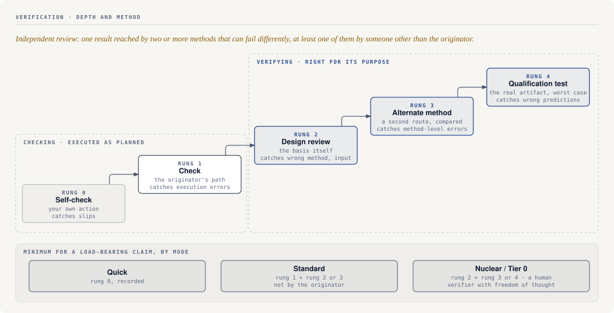
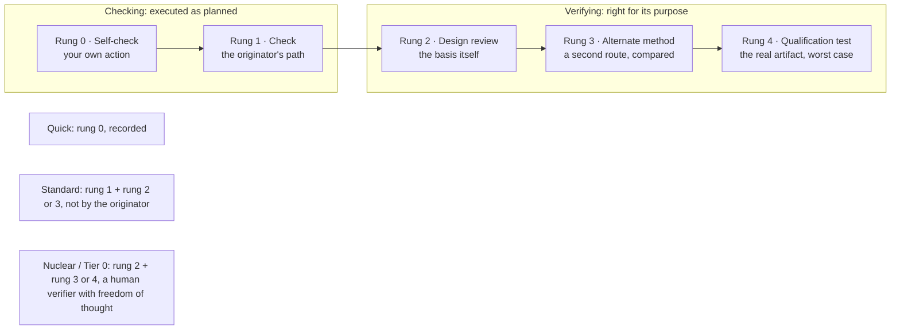

# Verification Methods and Depth

**Purpose:** Give one vocabulary for *how hard* a check looked and *by what means*, so "it was
reviewed" is never mistaken for "it was verified." [`independence-architecture.md`](independence-architecture.md)
answers **who** checked and on which axis they were separate. This page answers the other two
questions a reviewer has to ask: **how deep** did the check go, and **did it reach the answer by a
different route**?

**Boundary:** Bounded software-workflow translation of public nuclear quality and human-performance
vocabulary. It does not create formal verification and validation, design verification under any
regulation, compliance, certification, or any safety, security, or regulatory guarantee.

---

## Two words that are not synonyms

- **Checked** means a second party followed the originator's path and found it executed correctly:
  the arithmetic, the transcription, the inputs matching their sources, the steps matching the plan.
  A check inherits the originator's method, and therefore its blind spots.
- **Verified** means the result was confirmed to be *right for its purpose*, either by judging the
  basis itself (design review) or by reaching the result another way (alternate method, qualification
  test). Verification can disagree with a flawless check.

These two definitions are this repo's own. The sources below do not draw the line the same way.
10 CFR 50 Appendix B, Criterion III, treats "verifying or checking the adequacy of design" as one
process and gives examples of how: "such as by the performance of design reviews, by the use of
alternate or simplified calculational methods, or by the performance of a suitable testing program."
It requires that process to be performed "by individuals or groups other than those who performed the
original design, but who may be from the same organization." The separation is from the
*originator*, not from the organization. DOE-HDBK-1028-2009 uses the words differently again:
“Checking” refers to the confirmation of a correct action – prevention of an error by a performer.
“Verification” refers to the confirmation of the condition of equipment or accuracy of documents
consistent with the requirements of the governing documents. What this page takes from Appendix B is
the set of example methods (review, an alternate route to the answer, and testing) and the
originator-separation rule. It does not take a check/verify distinction from it.

## The ladder

Depth (how hard the check looked) and independence (who looked, and how separate they were) are two
different axes, not one ladder. A fully independent reviewer can do a shallow check, and a deep
qualification test can still be designed and read by the original author. Record both.

Each rung names what is examined and what it can catch. Higher rungs do not replace lower ones;
they catch different failures.

Mermaid source (text version)

| Rung | Method | What is examined | Catches | Cannot catch | Software / agent form |
|---|---|---|---|---|---|
| 0 | **Self-check** | your own action or output, by you | slips and lapses at the point of action | anything your framing hides | STAR before a risky command; re-reading your own diff |
| 1 | **Check** | the originator's work, along the originator's path | execution errors: wrong input copied, off-by-one, step skipped | a wrong method, a wrong assumption, a wrong requirement | a second party re-runs the author's tests and reads the diff against the plan |
| 2 | **Design review** (deep review) | the basis: requirements, inputs, assumptions, method choice, and whether the conclusion follows | a correct calculation of the wrong thing; unstated assumptions; a method that does not fit the purpose | defects that only appear when the thing runs | a reviewer given the basis and the candidate, *not* the author's conclusion, who must state whether the approach is right |
| 3 | **Alternate method** | the same result, reached by a different route, then compared | errors common to the original method, including ones a reviewer would also read past | errors common to *both* methods (name the common cause) | an independent oracle or second implementation; a property test beside example tests; a hand derivation against the code's output; a second primary source for a fact; a different model family for a judgment, counted as partial diversity only, since LLM errors are strongly correlated across families |
| 4 | **Qualification test** | the real artifact under the most adverse credible conditions | behavior the source and the review both predicted wrongly | conditions nobody thought to include | run the produced artifact on worst-case, boundary, and fault-injected inputs ([`verifying-final-artifacts`](../../skills/verifying-final-artifacts/SKILL.md), [`stress-testing-agent-changes`](../../skills/stress-testing-agent-changes/SKILL.md)) |

Appendix B's third example is "a suitable testing program." It adds that when a test program is used
*in lieu of* other verifying or checking processes, it "shall include suitable qualifications testing of a prototype unit under the most
adverse design conditions." The software reading: a happy-path test run is not a substitute for
review or an alternate method; only a deliberately adverse test can stand in for them.

## Timing and separation of the second party

The human-performance vocabulary in DOE-HDBK-1028-2009 grades *when* and *how separately* a second
person confirms:

- **Peer-check** — two people at the same time and place, before and during a specific action, both
  self-checking in parallel, to stop the performer's error.
- **Concurrent verification** — two people, same time and place, separately confirm a condition
  before, during, and after an action.
- **Independent verification** — one person, separated in time and distance from the performer,
  confirms the result afterward, without relying on the performer's observation or say-so. The
  handbook's test: "Independence exists when the verifier has freedom of thought from the performer."
- **Peer review** — a fresh set of eyes reads another's work product to catch errors before it is
  complete, or to confirm a decision or plan is appropriate before proceeding.

For agents, "freedom of thought" is the operative condition. A verifier that is handed the actor's
summary, preferred answer, or chosen evidence does not have it, whatever its role label. Brief the
verifier from the basis and the raw artifacts; withhold the actor's conclusion where feasible
([`evaluation-integrity.md`](evaluation-integrity.md) §2).

## Independent review means more than one means

An *independent review* in this repo is not one more reader. It is a result that has been reached
by **at least two methods that can fail differently**, at least one of them by a party other than
the originator. Two passes of the same method by two agents of one model family on one brief are
one method ([`independence-architecture.md`](independence-architecture.md) — "name the common-cause
analysis").

Worked contrast, for the claim "the retry budget caps total wait at 30 s":

- *Check:* a reviewer reads the backoff loop and confirms it matches the plan. Agrees.
- *Design review:* a reviewer asks whether 30 s is the right cap for the caller's timeout. Finds the
  caller times out at 20 s. The check could not have found this.
- *Alternate method:* a property test sums the actual sleeps over random seeds and jitter. Finds
  jitter can push the total to 34 s. Neither reader found this.

## Two checkers: compare, then adjudicate

When two parties check the same work, have each reach a result on their own, then compare the
results and resolve every disagreement against the source. Do not have one read the other's answer
and agree with it. Independence is what makes a disagreement visible. In a randomized study of data
abstraction for systematic reviews, abstractor experience mattered little and adjudication is what
reduced errors (E et al., *Research Synthesis Methods*, 2020). Agreement between two checkers is
evidence they apply the same rule, not that the rule gives the right answer. Two checkers can agree
on the same wrong answer.

## When you cannot check everything

- **Define the error first.** Write down what counts as wrong before looking, so the definition
  cannot drift to fit what you find.
- **Check every critical item.** A wrong legal citation, money amount, or security setting is one
  failure too many, whatever the sample says. Sample only the rest, at random.
- **Report a clean sample as a bound, not as "all correct".** If n randomly chosen items all pass,
  the one-sided 95% upper bound on the error rate is 1 − 0.05^(1/n), about 3/n. That is 5% for 59
  clean items, 1% for 299, and about 53% for 4. Four clean spot-checks show the method ran, not that
  the work is accurate. The bound assumes items were drawn at random from the population and fail
  independently. It does not hold as written for a hand-picked sample or for defects that cluster.
- **Split the results by kind.** A good overall rate can hide a category that is failing. Report
  critical items, each source type, and each field separately when they differ.
- **Measure the checker before relying on it.** Mix known-bad and known-good items into its work,
  unlabeled, and record how many bad items it flags and how many good items it wrongly flags. A
  checker tested only on bad items tells you nothing about false alarms, and false alarms dominate
  when real errors are rare. The repo does not yet tool this; it is the method for qualifying an agent
  checker ([`independence-architecture.md`](independence-architecture.md), "Qualify what you rely on").

## Graded by mode

| Mode | Minimum for a load-bearing claim |
|---|---|
| Quick | self-check (rung 0), recorded |
| Standard | a check (rung 1) **and** at least one of design review or alternate method (rung 2 or 3), performed by someone other than the originator |
| Nuclear / Tier 0 | design review (rung 2) **and** an alternate method or qualification test (rung 3 or 4) that cannot share the first method's common cause; the verifier has freedom of thought from the actor; a human is in the verification path; a trust-bearing verdict goes to a [panel](../../skills/running-a-review-panel/SKILL.md) |

Where a mode's minimum is not met, the gap is recorded as residual risk in `ship.md`, not hidden
behind a `pass`.

## Recording it

- `verification.md` → **Verification type** column: name the rung (`check`, `design review`,
  `alternate method`, `qualification test`) rather than just "review."
- An **alternate method** record names the original method, the alternate method, why the two can fail
  differently (different data, assumptions, or implementation), the comparison tolerance, and what was
  done with any disagreement. Two runs that share the same data, assumptions, or code are one method.
- Custody classification ([`actor-evidence-independence.md`](actor-evidence-independence.md)):
  a second party re-running the author's path is `independent reproduction`; an alternate method or
  qualification test by a separated party is `diverse verification`; a second party watching the
  action as it happens is `direct witnessing`.
- `ng validate --two-party` is a declared two-party integrity check: it fails a `pass` claim with no
  declared verifier distinct from the change actor. It checks declared actor separation only, not
  evidence or method independence, and cannot tell whether the rung was really climbed.
  That judgment stays with the reviewer.

## Red flags

- "Reviewed" or "verified" with no rung named.
- A design review whose brief included the author's conclusion.
- An "alternate" method that reuses the original's tests, oracle, or source.
- A test program used in place of review that contains only expected-path cases.
- The verifier relied on the actor's narration of the result instead of the artifact.

## How it connects

- [`independence-architecture.md`](independence-architecture.md) — who is separate, and on which axis.
- [`actor-evidence-independence.md`](actor-evidence-independence.md) — custody roles and the five-axis profile.
- [`evaluation-integrity.md`](evaluation-integrity.md) — judge bias and panels.
- Skills: [`proving-claims`](../../skills/proving-claims/SKILL.md) (claim → evidence),
  [`checking-facts`](../../skills/checking-facts/SKILL.md) (facts against primary sources by two means),
  [`reviewing-code-quality`](../../skills/reviewing-code-quality/SKILL.md) (rung 1–2 for code),
  [`verifying-final-artifacts`](../../skills/verifying-final-artifacts/SKILL.md) and
  [`stress-testing-agent-changes`](../../skills/stress-testing-agent-changes/SKILL.md) (rung 4),
  [`running-a-review-panel`](../../skills/running-a-review-panel/SKILL.md) (several methods on one verdict).

## Source-lineage note

Original Nuclear-grade operating doc. The check/verify definitions and the rung ladder are this
repo's own. Concept lineage: the example methods for verifying or checking a design (design reviews,
alternate or simplified calculational methods, a suitable testing program, with qualification
testing under the most adverse design conditions when testing stands in for the others) and the
originator-separation rule from 10 CFR 50 Appendix B, Criterion III; the peer-check, concurrent
verification, independent verification ("freedom of thought from the performer"), and peer review
definitions from DOE-HDBK-1028-2009 Volume 2; correlated errors across LLMs from Kim et al. (ICML
2025); and adjudication of independent checks from E et al. (*Research Synthesis Methods*, 2020).
The zero-failure bound is elementary binomial arithmetic. All are mapped in
[`../00-standards-foundation/source-map.md`](../00-standards-foundation/source-map.md); quotations were
checked against the eCFR text and the DOE handbook PDF on 2026-11-03. This page borrows vocabulary;
it does not claim to meet either source.
