# Banner options

Three choices for the top of the README. All three move on GitHub and stop moving for anyone who has asked their system for reduced motion. All three read fine as a still picture too.

## A. Control rods

Control rods slide down into a glowing core, the glow settles, and the install line sits under the tagline with a blinking cursor. The calm, in-control feeling is the point of the project.

## B. Core glow

The current layout, with a slow blue reactor glow behind the title, a light that sweeps along the colored rule, and a few sparks rising. The install line sits in a pill under the tagline. The closest to what's there today.

## C. Live guard

A terminal plays a short session: install, set up a repo, the guard stops an agent edit to the CI workflow, asks a person before a force push, and the record check passes. It shows what the tool does before anyone scrolls. On a phone the terminal text gets small.

